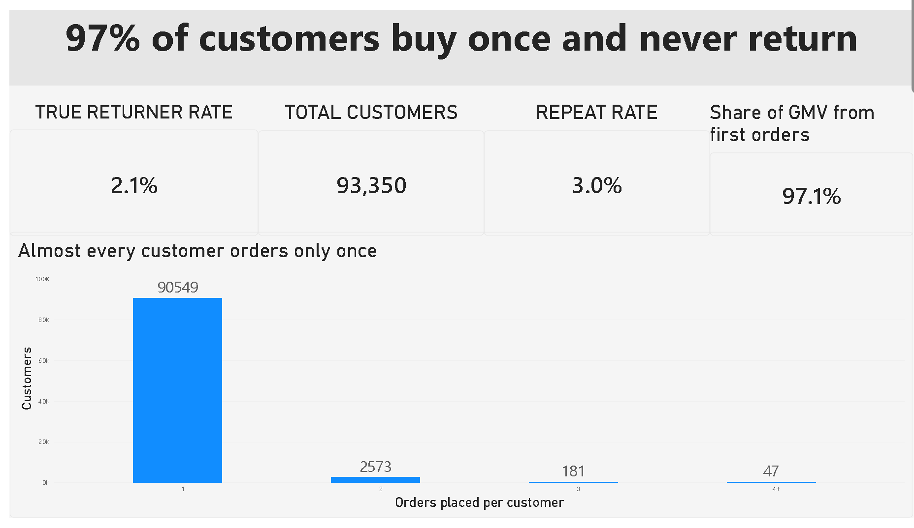

# Olist Customer Retention Analysis

**Is retention worth fixing at a Brazilian e-commerce marketplace, and where should a team spend first?**

An end-to-end analytics project framed as a consulting case, using the public Olist dataset (2016-2018). It covers data cleaning, cohort analysis and a Power BI dashboard, and ends with a sized, evidence-backed recommendation.



## Key Findings

| Metric | Result |
|---|---|
| Total customers | 93,350 |
| Repeat rate (2+ orders) | 3.0% |
| True returner rate (excluding same-day orders) | 2.1% |
| Share of GMV from first orders | 97.1% |
| Median days to a true second order | ~75 (likely longer, see limitations) |
| 90-day return rate | ~1.3%, flat across Feb 2017 - May 2018 cohorts |

- **Most customers buy once.** 90,549 of 93,350 customers placed a single order.
- **About 30% of repeat customers reordered the same day**, which is probably a split cart rather than a real return, so these are excluded from "true" returners.
- **Retention is not improving.** Monthly cohorts stay near 1.3%, including November 2017, the biggest cohort (7,059 customers), at 1.33%.
- **First-order category is the strongest signal.** Fashion accessories (2.29%), bed/bath/table (1.94%) and sports/leisure (1.67%) retain best.
- **Delivery performance shows no clear effect** on 90-day return rate, and review score shows only a slight one.

## Recommendation

1. Don't invest in blanket delivery or loyalty fixes.
2. Target retention at categories that already retain well.
3. A/B test a low-cost reminder in the 2-3 month window (around the median gap).

**Sizing the prize** (lower bound, based on 74,404 customers in the Feb 2017 - May 2018 cohorts):

| Return-rate uplift (points) | Extra returners | Extra GMV (R$) |
|---|---|---|
| 0.5 | 372 | 45,718 |
| 1.0 | 744 | 91,436 |
| 2.0 | 1,488 | 182,871 |

These are alternative scenarios, not cumulative. Each assumes one extra order per extra returner at the average repeat order value of R$122.89.

## Methodology

1. **Data prep:** joined orders, customers, items, payments, reviews and products. Used `customer_unique_id` (not `customer_id`) to identify repeat buyers.
2. **Order filtering:** [state which order statuses you kept, e.g. delivered only].
3. **Return definition:** a customer is a true returner if they place a second order on a later day than their first. Same-day orders are excluded.
4. **Cohorts:** customers grouped by first-order month, with a 90-day return window per cohort.
5. **Category:** assigned from the most expensive item in the first order.
6. **Segment comparisons:** [state the test used for "higher than rest", e.g. two-proportion z-test, and any minimum cohort size].
7. **Visualization:** Power BI dashboard with four pages (see below).

## Dashboard Pages

1. **97% of customers buy once and never return:** headline KPIs and order-count distribution
2. **Returners are slow, and retention isn't improving:** time to second order and 90-day return rate by cohort
3. **Category matters most; delivery barely does:** return rate by category, delivery performance and review score
4. **Retention is a modest prize:** uplift scenarios and recommendations

## Limitations

- **Associations, not causes.** Category and delivery effects are not proven drivers of repeat purchase.
- **GMV, not profit.** Figures use item value excluding freight. The dataset has no margin or cost data.
- **Right-censoring.** Gaps over 90 days are only observable for earlier cohorts, so the true median time to a second order is likely longer than 75 days.
- **Lower-bound scenarios.** Each extra returner is counted as one extra order.
- **Small segments are noisy.** Some categories have few customers, so their rates are less reliable.
- **Context.** This is a 2016-2018 Brazilian marketplace, so results may not transfer to other markets or years.

## Tech Stack

- [SQL (PostgreSQL / SQLite / BigQuery) and/or Python (pandas)]
- Power BI Desktop
- Dataset: [Olist Brazilian E-Commerce Public Dataset](https://www.kaggle.com/datasets/olistbr/brazilian-ecommerce) on Kaggle

## Repository Structure

```
├── data/              # raw Olist CSVs (not committed, see Setup)
├── sql/               # cleaning and cohort queries & exploratory analysis
├── dashboard/         # Power BI .pbix file
├── olist_retention_analysis_dashboard.pdf
└── README.md
```

## Setup

1. Download the dataset from Kaggle and place the CSVs in `data/`.
2. Run the queries in `sql/` in order (or the notebook in `notebooks/`) to build the analysis tables.
3. Open `dashboard/olist_retention.pbix` in Power BI Desktop and refresh the data source path.

## Author

**Milind**
[GitHub](https://github.com/Milind2805) | [LinkedIn](https://www.linkedin.com/in/milind-kumar-singh-a84173382)
